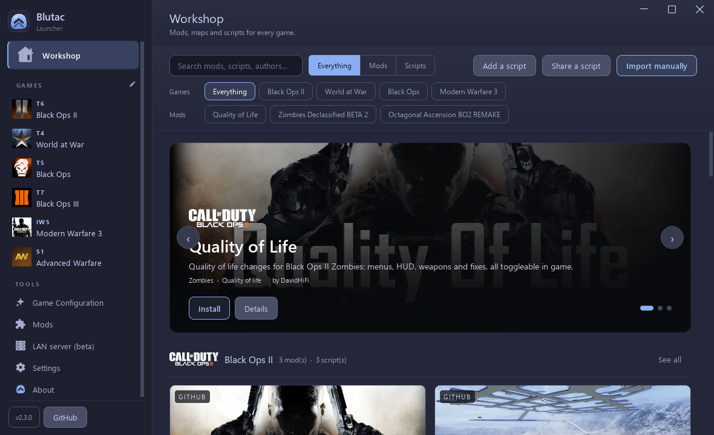

<div align="center">



# Blutac Launcher

**Install, update and launch Call of Duty mods and GSC scripts on [Plutonium](https://plutonium.pw).**

One window for the [Quality of Life series](https://github.com/DavidHiFi/Plutonium-QoL-Series), community mods, standalone scripts, LAN and online play, ReShade and a LAN server.

<a href="https://github.com/DavidHiFi/Blutac-Launcher/releases/latest">

</a>

<br><br>


</div>

---

## Installation

1. Download the **Setup** `.exe` from the [latest release](https://github.com/DavidHiFi/Blutac-Launcher/releases/latest) and run it. It installs for your user only, needs no admin rights, and adds Start menu and desktop shortcuts.
2. Run the app. The first-run wizard asks for your name, a theme, your Plutonium folder and your game folders.
3. Open **Game Configuration** in the sidebar and press **Install** on Black Ops II.
4. Open **Black Ops II**, pick **LAN** or **Online**, and press **Start**.

Prefer no installer? Unzip the **portable** `.zip` anywhere you can write to and run the exe inside it. The `.update.bin` file on the release page is for the app's own updater. Do not run it.

## Features

### Workshop

- **One catalog:** mods, custom maps and GSC scripts for every Plutonium game, with cover art.
- **Filters:** pick any mix of games, mods only or scripts only, and the mods a script was made for, such as Quality of Life or Zombies Declassified.
- **One-click scripts:** Install drops a script into the folder Plutonium loads it from. Remove sends it to the Recycle Bin.
- **Your own scripts:** Add a script copies a `.gsc` from your PC into the right folder for the game and mode you pick.
- **Share a script:** opens a short form on GitHub. Accepted scripts appear in everyone's Workshop.
- **Starter scripts:** a health readout for World at War, Black Ops and Black Ops II in Zombies and Multiplayer, and a zombies-left counter for each Zombies mode.

### Quality of Life series

- **One-click mods:** install, update or remove each game's Quality of Life mod.
- **Black Ops II extras:** HD texture pack, custom sounds and PlayStation 5, Switch or Xbox button prompts.
- **Backups:** every install first copies your own textures, sounds, icons, ReShade setup, scripts and settings.
- **Put it back:** restore any backup from the Game Configuration page, or remove a pack and get your originals back.

### Playing

- **Play page:** one page per game with its art, a LAN or Online choice and a Start button.
- **LAN:** starts the game with the selected mod already loaded.
- **Online:** signs in with your Plutonium account and starts the game without opening Plutonium's launcher.
- **ReShade:** colour grading for every Plutonium game, kept in place while you play.
- **DLSS 5:** an optional switch for Black Ops II LAN games, once you import it from a folder that already has it.

### Mods and servers

- **Mods page:** switch between installed mods and installed scripts. Drop a `.zip`, `.rar`, `.7z`, `.exe`, `.cll` or `.gsc` file, or paste a GitHub link.
- **Safe uninstall:** every mod install saves a checkpoint, so removing it restores what it replaced.
- **LAN server:** start and stop a dedicated server with generated configs.

### The app

- **Fifteen themes:** Nocturne, Classic Things, OLED, the four Catppuccin flavours and six T3 palettes.
- **Accent colour:** pick a swatch, type any `#rrggbb`, or follow your Windows accent.
- **Window material:** Solid, Mica, Mica Alt, Acrylic, Blur or Frosted glass, with a tint slider. The title bar uses the same material.
- **Title bar:** the standard Windows title bar, or Blutac's own.
- **Four languages:** English, Spanish, Brazilian Portuguese and Russian.
- **Self-updating:** checks this repo's releases when it starts.

### Supported games

| Code | Game | Client |
|---|---|---|
| T6 | Black Ops II | Plutonium |
| T4 | World at War | Plutonium |
| T5 | Black Ops | Plutonium |
| IW5 | Modern Warfare 3 | Plutonium |
| T7 | Black Ops III | T7-CLL or BOIII Community |
| S1 | Advanced Warfare | S1-CLL |

## Notes

> [!NOTE]
> **The Workshop, scripts, accent colour, window materials and title bar switch are new in the next release.** Version 2.3.0 has the older Home page. Build from source to try them now.

> [!IMPORTANT]
> **Plutonium deletes ReShade every time it starts.** Tick **ReShade** on the Play page, install it once, and a quiet watcher puts the files back as the game opens, then saves your in-game preset edits.

> [!NOTE]
> **Mods load on LAN only.** Online games start without a mod. Pick one from the game's own Mods menu once you are in.

> [!WARNING]
> **Scripts run inside your game.** Only install scripts from people you trust. The starter scripts for World at War and Black Ops have not been played in game yet.

> [!NOTE]
> **Settings live in `QualityOfLife.ini` next to the exe.** If your Plutonium folder is not `%LOCALAPPDATA%\Plutonium`, point the app at it from **Settings**.

<details>
<summary><b>Where scripts go</b></summary>

<br>

Blutac installs each script into the folder Plutonium loads loose scripts from, inside your Plutonium folder:

| Game | Zombies | Multiplayer |
|---|---|---|
| Black Ops II | `storage\t6\scripts\zm` | `storage\t6\scripts\mp` |
| Black Ops II, made for a mod | `storage\t6\mods\<mod>\scripts\zm` | `storage\t6\mods\<mod>\scripts\mp` |
| Black Ops | `storage\t5\raw\scripts\sp\zom` | `storage\t5\raw\scripts\mp` |
| World at War | `storage\t4\raw\scripts\sp` | `storage\t4\raw\scripts\mp` |
| Modern Warfare 3 | | `storage\iw5\scripts` |

</details>

<details>
<summary><b>Building from source</b></summary>

<br>

You need Qt 6 (Widgets, Network, Concurrent, Svg) with its MinGW kit, CMake and Ninja. The paths to all three sit at the top of `scripts\build.ps1`. Edit them if yours live elsewhere.

```powershell
powershell -ExecutionPolicy Bypass -File scripts\build.ps1 -Clean
dist\BlutacLauncher.exe -installcheck
dist\BlutacLauncher.exe -selftest -plutoniumdir <throwaway folder>
```

`build.ps1` writes `dist\` with the exe and the Qt runtime beside it. `scripts\build-setup.ps1 -NsisDir <NSIS folder>` checks every imported DLL, builds Setup with NSIS, unpacks the finished Setup into a throwaway folder and checks it again. `scripts\README.txt` covers the static single-exe route.

The version lives in `src/Version.h`. [AGENTS.md](AGENTS.md) explains the parts that are easy to break.

</details>

<details>
<summary><b>The two feeds</b></summary>

<br>

- `qol_home.json` is the Workshop catalog. Edit it and commit, and the app picks it up on its next start. A copy is built into the exe as a fallback. Scripts list a `file` path in this repo, under `workshop\scripts\`.
- `qol_update.json` is the update feed. Regenerate it after each release with `python scripts\gen_update.py -o qol_update.json`, then check it with `python scripts\gen_update.py --verify qol_update.json`. Never edit it by hand.

</details>

---

## Contributing

Bug reports with the game and mod involved, catalog fixes, new scripts and pull requests all help.

<a href="CONTRIBUTING.md">

</a>

## Star history

Thanks to everyone using the launcher, reporting catalog bugs and sending fixes.

<a href="https://www.star-history.com/?repos=DavidHiFi%2FBlutac-Launcher&amp;type=date">
  <picture>
    <source media="(prefers-color-scheme: dark)" srcset="https://api.star-history.com/chart?repos=DavidHiFi/Blutac-Launcher&amp;type=date&amp;theme=dark&amp;legend=top-left" />
    <source media="(prefers-color-scheme: light)" srcset="https://api.star-history.com/chart?repos=DavidHiFi/Blutac-Launcher&amp;type=date" />
    
  </picture>
</a>

## Credits

- **Author:** Myself, [DavidHiFi](https://github.com/DavidHiFi)

| Who | What |
|---|---|
| **MestreTM** ([Cod Lan Launcher](https://github.com/MestreTM/CLL-Cod-Lan-Launcher)) | The app this one is forked from, at v1.2.0. The games list, mod installer, LAN server, base themes and updater are its work. |
| **JugAndDoubleTap** ([LanLauncher](https://github.com/JugAndDoubleTap/LanLauncher)) | The original LAN launcher that Cod Lan Launcher grew from, and the 7-Zip download the kit importer uses. |
| **xerxes-at** ([T4](https://github.com/xerxes-at/T4ServerConfigs), [T5](https://github.com/xerxes-at/T5ServerConfig) and [T6](https://github.com/xerxes-at/T6ServerConfigs) server configs) | The dedicated server configs the LAN server page downloads. |
| **AlterWare** ([alterware.dev](https://alterware.dev)) | Some of the standalone client sources. |
| **BOIII Community** ([BOIII-Community](https://gitlab.com/boiii-community/BOIII-Community)) | The alternative Black Ops III client. |
| **Plutonium** ([loading mods](https://plutonium.pw/docs/modding/loading-mods/)) | The script folder layout the Workshop installs into. |
| **crosire** ([ReShade](https://reshade.me)) | ReShade, bundled unmodified for the colour grading. |
| **Catppuccin** ([catppuccin](https://github.com/catppuccin/catppuccin)) | The four Catppuccin colour palettes. |

Built on [Qt 6](https://www.qt.io), with [CMake](https://cmake.org), [Ninja](https://ninja-build.org), [MinGW-w64](https://www.mingw-w64.org), [NSIS](https://nsis.sourceforge.io) for Setup, [7-Zip](https://www.7-zip.org) for archives, [Python](https://www.python.org) for the feed scripts and [gsc-tool](https://github.com/xensik/gsc-tool) to check the starter scripts.

> Missing or wrong credit? [Open an issue](https://github.com/DavidHiFi/Blutac-Launcher/issues/new) and I'll fix it.

## Disclaimers

Cod Lan Launcher, the app this is forked from, was written by MestreTM. Most of the code this fork adds was developed with AI coding agents, including Claude Code and Codex. No single AI agent made the project.

Online play uses your Plutonium account. The app keeps your sign-in in Plutonium's own `config.json`, encrypted for your Windows user, exactly where the official launcher keeps it, and sends it only to Plutonium. Setup is not code-signed, so Windows SmartScreen may warn the first time you run it.

The app was called Quality of Life Mod Manager up to version 2.2. Installed copies keep updating from this repo under its new name.

The app is LGPL-3.0, the license it inherited from Cod Lan Launcher. See [LICENSE](LICENSE).

<div align="center">
<br>
<sub>Not affiliated with Activision, Treyarch or Plutonium. Requires your own copies of the games and <a href="https://plutonium.pw">Plutonium</a>.</sub>
</div>
